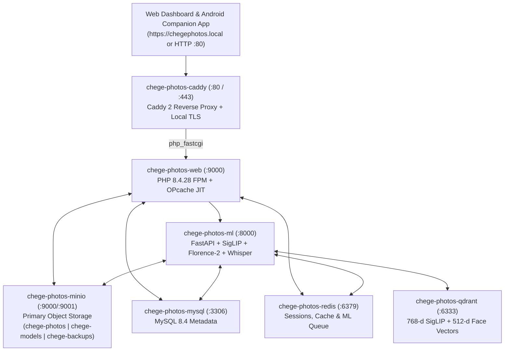

# Chege Photos Platform

**Chege Photos Platform** is a self-hosted, privacy-first photo and video management backend with local multimodal AI intelligence — zero cloud subscriptions and zero third-party AI APIs.

**Stack:** Caddy 2 (`https://chegephotos.local`) + PHP 8.4.28 FPM (CodeIgniter 4) · Python 3.12 FastAPI (SigLIP, Florence-2, Whisper Large-v3-Turbo, InsightFace, YOLOv8n, OpenNSFW) · MySQL 8.4 · Redis 7 · Qdrant · MinIO S3.

> **If you only need to deploy and run the platform, this page is enough.**  
> Software engineers & contributors: see [docs/README.md](docs/README.md) and [CONTRIBUTING.md](CONTRIBUTING.md).

---

## System Overview



---

## Quick Start (Docker Compose)

### 1. Prerequisites
- Docker Engine 24+ & Docker Compose v2
- *(Optional)* NVIDIA GPU + NVIDIA Container Toolkit — automatically detected by `scripts/deploy.sh`

### 2. Configure & Deploy
```bash
git clone <your-repo-url> chege-photos-platform
cd chege-photos-platform
cp .env.example .env
# Edit .env to set strong passwords and ML_API_KEY
bash scripts/deploy.sh
```

`scripts/deploy.sh` automatically:
1. Detects NVIDIA GPU hardware (`WHISPER_DEVICE=cuda` / `float16` / `cu124`) or defaults to CPU (`int8`).
2. Pulls latest base images and builds patched **PHP 8.4.28 FPM** + **FastAPI ML** (`ffmpeg` included).
3. Starts stateful engines (`mysql`, `redis`, `qdrant`, `minio`), creates `chege-photos`, `chege-models`, and `chege-backups` buckets, and seeds AI model weights directly into `minio://chege-models/`.
4. Starts stateless `chege-photos-web`, `chege-photos-nginx`, and `chege-photos-ml`, then runs database migrations and health assertions.

---

## Running Services & Ports

| Container | Role | URL / Port | Notes |
| :--- | :--- | :--- | :--- |
| `chege-photos-caddy` | Reverse Proxy & Local HTTPS | `https://chegephotos.local` / `:80` | `tls internal`, HTTP/3, `/logs*`, `/ml/*`, Android `:80` |
| `chege-photos-web` | PHP 8.4.28 FPM + OPcache JIT | Internal `:9000` | Stateless compute; patched for CVE-2026-126714 |
| `chege-photos-ml` | FastAPI Multimodal AI Service | `http://localhost:8000/docs` | SigLIP, Florence-2, Whisper, InsightFace, YOLO |
| `chege-photos-minio` | Primary S3 Object Storage | `http://localhost:9000` / `:9001` | Stores all media, AI models & cold backups |
| `chege-photos-qdrant` | Vector Search Engine | `http://localhost:6333/dashboard` | 768-d SigLIP + 512-d ArcFace embeddings |
| `chege-photos-mysql` | Relational Database | `localhost:3306` | Metadata, users, albums, captions, transcripts |
| `chege-photos-redis` | Sessions, Cache & Job Broker | `localhost:6379` | Append-only persistence + async ML queue |
| `chege-photos-dozzle` | Live Container Log Viewer | `http://localhost:8888` | Real-time container stdout/stderr |

---

## Common Operator Commands

```bash
# Fast restart without rebuilding images
bash scripts/deploy.sh --fast

# Re-index existing library with 768-d SigLIP, Florence-2 captions & Whisper transcripts
docker compose exec -T web php spark ml:reindex-siglip

# Stream compressed MySQL dump + Qdrant snapshots to minio://chege-backups/
docker compose exec -T web php spark backup:minio

# Sync or verify AI weights in minio://chege-models/
bash scripts/download-models.sh --verify

# Stop stack cleanly
docker compose down
```

---

## Documentation & Links
- **Engineering Handbook:** [docs/README.md](docs/README.md)
- **Architecture Overview:** [docs/architecture/overview.md](docs/architecture/overview.md)
- **MinIO Storage & Vector Design:** [docs/architecture/data-and-storage.md](docs/architecture/data-and-storage.md)
- **AI / ML Pipeline Guide:** [docs/services/ml.md](docs/services/ml.md)
- **Backup & Restore Runbook:** [docs/runbooks/backup-and-restore.md](docs/runbooks/backup-and-restore.md)
- **License:** [MIT License](LICENSE)
