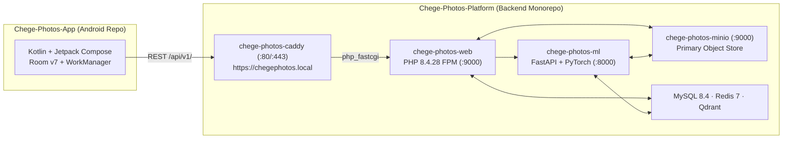

# Chege Photos Platform — Engineering Documentation

Welcome to the engineering handbook for **Chege Photos Platform** (`chege-photos`). For quick operator setup, see the root [README.md](../README.md).

---

## Documentation Map

### Architecture
- [System Overview](architecture/overview.md) — C4 containers, Caddy 2 + PHP 8.4.28 FPM split, stateless compute model, two-repo boundaries
- [Data & Storage](architecture/data-and-storage.md) — MinIO-primary buckets (`chege-photos`, `chege-models`, `chege-backups`), POSIX vs Object storage boundary, Qdrant 768-d/512-d collections
- [Communication & Sequences](architecture/communication.md) — Upload, zero-disk MinIO streaming, async Redis ML queue, auth flows
- [Deployment](architecture/deployment.md) — Docker Compose, GPU auto-detection (`docker-compose.gpu.yml`), race-free `scripts/deploy.sh`
- [Threat Model](architecture/threat-model.md) — STRIDE analysis, PHP 8.4.28 CVE mitigations, Vault isolation

### Services
- [CodeIgniter 4 WebApp (PHP 8.4.28 FPM + Caddy 2)](services/codeigniter.md)
- [FastAPI Gateway](services/fastapi.md)
- [AI & ML Pipelines (SigLIP, Florence-2, Whisper, InsightFace, YOLO, OpenNSFW)](services/ml.md)

### Operations & Engineering
- [Backup & Restore Runbook](runbooks/backup-and-restore.md)
- [Graceful Restart Runbook](runbooks/restart.md)
- [Local Development](engineering/local-development.md) · [Database Migrations](engineering/database.md) · [Testing](engineering/testing.md) · [Security](engineering/security.md)
