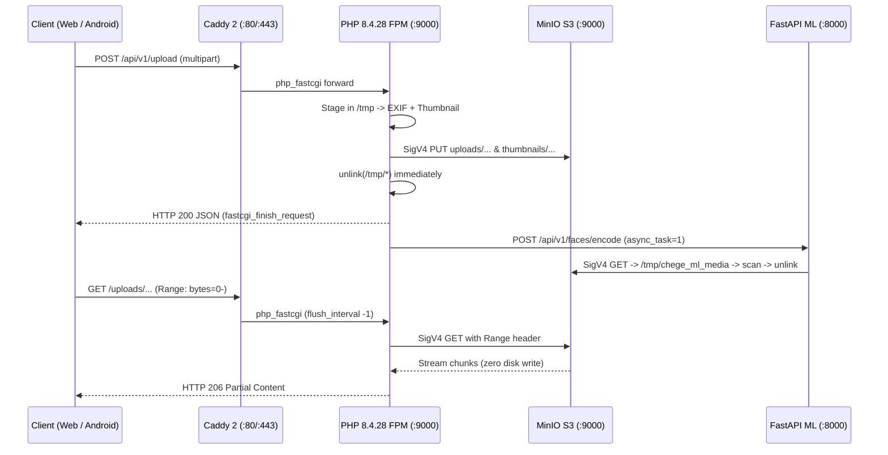

# Data & Storage Architecture

## Storage Boundary: Object Storage vs. POSIX Engine Volumes

| Data Class | Storage Location | Why |
| :--- | :--- | :--- |
| **User Photos, Videos, Thumbnails, Avatars, Vault** | `minio://chege-photos/` | Durable S3 object storage; zero host disk footprint on Web/ML containers. |
| **AI Model Weights (ONNX, Safetensors, CTranslate2)** | `minio://chege-models/` | Centralized artifact registry; ML container stays lean and stateless. |
| **Cold Backups (MySQL dumps, Qdrant snapshots)** | `minio://chege-backups/` | Automated via `php spark backup:minio`. |
| **MySQL Engine Files (`/var/lib/mysql`)** | Docker volume `chege-photos-mysql` | InnoDB requires 16KB atomic POSIX random I/O and `fsync()`. |
| **Qdrant Vector Files (`/qdrant/storage`)** | Docker volume `chege-photos-qdrant` | HNSW vector index relies on `mmap` and WAL. |
| **Redis Persistence (`/data`)** | Docker volume `chege-photos-redis` | AOF sequential appends for sessions and `chege:ml:scan:queue`. |
| **MinIO Data (`/data`)** | Docker volume `chege-photos-minio` | Physical backing store for MinIO object chunks. |

---

## MinIO Bucket Layout

```text
minio://chege-photos/
├── uploads/users/{user_id}/{YYYY}/{MM}/{random}.{ext}
├── uploads/avatars/user_{user_id}_{ts}.{ext}
└── thumbnails/users/{user_id}/{YYYY}/{MM}/{random}.jpg

minio://chege-models/
├── insightface/buffalo_l/         (det_10g.onnx, w600k_r50.onnx, genderage.onnx, ...)
├── yolo/yolov8n.onnx
├── nsfw/open_nsfw.onnx
├── siglip/google--siglip-base-patch16-224/
├── florence2/microsoft--Florence-2-base/
└── whisper/large-v3-turbo/

minio://chege-backups/
├── mysql/{db_name}_{YYYYMMDD_HHMMSS}.sql.gz
└── qdrant/{collection}/{YYYYMMDD_HHMMSS}_{snapshot}
```

---

## Stateless Upload & Zero-Disk Streaming Sequence



---

## Qdrant Vector Collections

| Collection | Dimensions | Distance | Model | Payload Indexes |
| :--- | :---: | :---: | :--- | :--- |
| `photo_embeddings` | **768** | Cosine | `google/siglip-base-patch16-224` (images + video transcripts) | `user_id`, `photo_id` |
| `face_embeddings` | **512** | Cosine | InsightFace `buffalo_l` (`w600k_r50.onnx`) | `user_id`, `photo_id` |
| `face_embeddings_centroids` | **512** | Cosine | Incremental person centroids | `user_id` |
