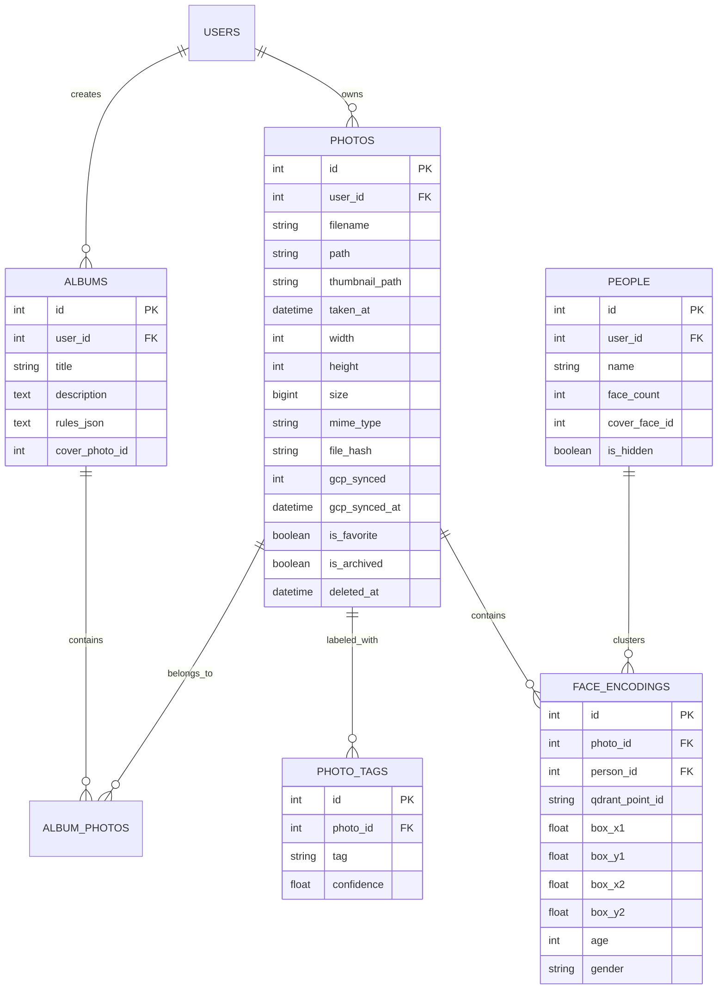

# Data, Schema & Storage Architecture

Relational database schemas, local disk hierarchies, Google Cloud Storage mirroring, and ephemeral rehydration patterns for Chege Photos WebApp.

---

## 1. Storage Layout & Directory Structure

All media is organized in a strict user-isolated and date-based hierarchy under `public/`:

```
public/
├── uploads/
│   └── users/
│       └── {user_id}/
│           └── {YYYY}/
│               └── {MM}/
│                   └── {random_name}.jpg       # Original photo/video file
└── thumbnails/
    └── users/
        └── {user_id}/
            └── {YYYY}/
                └── {MM}/
                    └── {random_name}.jpg       # Web-optimized thumbnail
```

---

## 2. Multi-Cloud & S3 Object Storage Abstraction (`StorageManager.php`)

Chege Photos Platform decouples binary media storage from local container disks using a unified storage abstraction layer:

1. **Default Storage Engine (MinIO / S3)**:
   - Media (originals and thumbnails) is stored in S3-compatible buckets (`chege-photos`).
   - Out-of-the-box local orchestration runs **MinIO** (`cgr.dev/chainguard/minio`) on port `9000` (S3 API) and `9001` (Web Console).
   - All HTTP requests implement standard **AWS Signature Version 4 (SigV4)** signing with path-style URL addressing.
2. **Multi-Cloud Backups (AWS S3 & Google Cloud Storage)**:
   - Configurable via `STORAGE_DRIVER` (`minio`, `s3`, `gcp`, or `local`).
   - Optional offsite disaster recovery synchronization to Google Cloud Storage (`GCP_BUCKET`) via `php spark cloud:sync`.
3. **ML Microservice Shared Access**:
   - The ML service reads objects directly via S3 streaming / pre-signed URLs or via the read-only volume mount `/app/uploads:ro`.

---

## 3. Redis 7 In-Memory Session & Queue Layer

Redis 7 operates as the platform's high-speed in-memory engine:

* **Primary Session Handler**: User web sessions are managed in Redis with low-millisecond lookup latency. In case of Redis restarts, the platform automatically falls back to MySQL `ci_sessions`.
* **Asynchronous Queue Broker**: Offloads heavy tasks (face scan jobs, thumbnail pre-warming, vector sync) to background queues, keeping HTTP response times under 50ms.

---

## 4. Qdrant Vector Search Engine

High-dimensional embeddings are indexed in Qdrant for real-time similarity search:

* **`face_embeddings` Collection**:
  - Dimension: `512` (ArcFace L2-normalized float32 unit vectors).
  - Distance Metric: `Cosine`.
  - Payloads: `user_id`, `photo_id`, `box`, `confidence`, `det_score`.
* **`clip_embeddings` Collection**:
  - Dimension: `512` (OpenAI CLIP ViT-B/32 multimodal vision vectors).
  - Distance Metric: `Cosine`.
  - Natural-language semantic queries are embedded on-the-fly and queried against image vectors in < 15ms.
* **Multi-Tenant Isolation**: Every vector query enforces a strict filter on `user_id` to prevent cross-account information leakage.

---

## 5. Hybrid Ephemeral Rehydration Pattern (`MediaFallback.php`)

To support cloud platforms with ephemeral disks (Railway, Render, Fly.io), the WebApp implements the **Hybrid On-Demand Rehydration Pattern**:

1. **Request Interception**: Missing image requests under `uploads/` or `thumbnails/` hit Apache's rewrite rules and route to `MediaFallback::serveMedia()`.
2. **Subpath Preservation**: The controller sanitizes each component of the path individually to prevent directory traversal while preserving the full directory structure:
   ```php
   $segments = explode('/', $subPath);
   $sanitized = array_map('basename', $segments);
   $cleanPath = implode('/', $sanitized);
   ```
3. **Bucket Retrieval**: `StorageManager` / `GcpStorageService` streams the object from S3/MinIO/GCP.
4. **Local Cache Rehydration**: The parent directories (`users/{id}/{YYYY}/{MM}/`) are automatically created on local disk (`mkdir($dir, 0777, true)`), and the file is written to local disk for subsequent zero-overhead requests before streaming to the client.

---

## 6. Database Schema Reference (MySQL 8.4)

Managed via 24 versioned CodeIgniter migrations in `app/Database/Migrations/`:



---

## 4. Key Table Schemas

### `tbl_photos`
The primary catalog table. Key columns include:
- `file_hash` (`VARCHAR(64)`): SHA-256 binary hash used for duplicate detection.
- `gcp_synced` (`TINYINT(1)`): Flag indicating whether the file has been mirrored to GCS (`1` = yes, `0` = pending).
- `gcp_synced_at` (`DATETIME`): Timestamp of last cloud sync.
- `deleted_at` (`DATETIME`): CodeIgniter soft-delete timestamp. Trashed photos are purged after 60 days via `php spark trash:purge`.

### `tbl_photo_tags`
Stores real-world object labels detected by the YOLOv8 model in the ML microservice. Joined during Explore searches and tag filtering.

### `tbl_face_encodings`
Stores face metadata and bounding box landmarks. The high-dimensional 512-d feature vector is indexed in **Qdrant** using `qdrant_point_id` (`VARCHAR(36)`), keeping the MySQL table fast and light.
