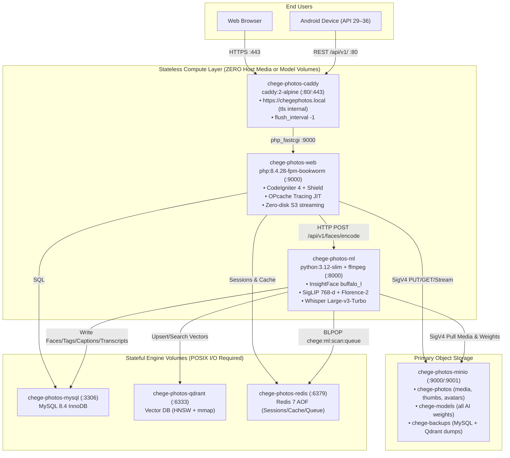

# System Architecture Overview

Chege Photos uses a **Two-Repo Architecture** paired with **100% stateless compute containers** and **MinIO as primary object storage**.

---

## C4 Container Diagram

---

## Core Architectural Principles

1. **Strict Client Isolation:** The Android app (`Chege-Photos-App`) communicates **exclusively** with `chege-photos-caddy` on standard Port `80` / `443` (`/api/v1/...`). It has zero direct network access to ML, Redis, Qdrant, or MinIO.
2. **NTS PHP 8.4.28 FPM + Caddy 2:** Decouples HTTP/3 + local TLS (`https://chegephotos.local`) and static asset delivery (Caddy) from PHP application execution (Non-Thread-Safe PHP-FPM workers with OPcache Tracing JIT). Activates `fastcgi_finish_request()` for instant upload responses.
3. **Stateless Web & ML Containers:** Neither `chege-photos-web` nor `chege-photos-ml` mounts host media or model directories. Ephemeral `/tmp` scratch files are purged immediately after upload or inference.
4. **POSIX vs. Object Storage Separation:** Transactional engines (`mysql`, `qdrant`, `redis`) and `minio` itself retain minimal local Docker volumes for POSIX I/O, while all user media, AI model weights, and cold backups live in MinIO.
