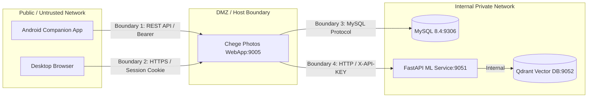

# Threat Model & Security Hardening

STRIDE security evaluation, threat boundary analysis, local Wi-Fi attack vectors, and specific code mitigations for Chege Photos WebApp.

---

## 1. System Security Boundaries

Chege Photos WebApp manages private user photos, facial biometrics, encrypted vault items, and authentication credentials. Three primary trust boundaries exist:



---

## 2. STRIDE Threat Analysis

| Threat Category | Target Surface | Specific Threat Scenario | Code & Infrastructure Mitigation |
|---|---|---|---|
| **Spoofing** | Mobile Pairing & API Auth | An attacker on the local Wi-Fi attempts to forge pairing requests or guess active bearer tokens. | 6-digit numeric pairing codes expire within 10 minutes. Hardware fingerprints are bound to tokens upon exchange. Tokens use cryptographic random 64-character hex strings stored hashed in `tbl_personal_access_tokens`. |
| **Tampering** | File Uploads & Cloud Rehydration | Uploading malicious polyglot files or exploiting subpath traversal during cloud fallback. | MIME validation against file magic bytes (`finfo_file`). Path traversal defense in `MediaFallback.php` decomposes paths using `explode('/', $path)` and sanitizes each segment via `basename()`. |
| **Repudiation** | Vault Actions & Bulk Deletions | A malicious actor deletes or modifies albums/photos and denies doing so. | All authentication failures, permission rejections, PIN attempts, and administrative wipes log into `tbl_security_audit` with client IP and user agent. |
| **Information Disclosure** | Multi-Tenant Data & Media URLs | Tenant A accesses Tenant B's private photos via direct primary key enumeration (IDOR) or SQL condition leak. | Strict query scoping with `groupStart()` and `groupEnd()`. All resource lookups filter explicitly on `user_id = auth()->id()`. Direct media URLs use unguessable cryptographic SHA-256 tokens. |
| **Denial of Service** | ML Inference & Large Uploads | Flooding concurrent raw video uploads or batch scanning requests to exhaust memory. | WebApp limits concurrent upload streams (`upload-limits.ini`). Asynchronous non-blocking dispatch to ML service prevents web worker starvation. |
| **Elevation of Privilege** | Private Locked Vault | A standard user escalates privileges to view private locked vault media without supplying vault PIN. | Vault status and PIN hashes are checked server-side in `Vault::unlock()`. Unlocked state is kept in an ephemeral session variable with a 15-minute inactivity timeout. |

---

## 3. Local Wi-Fi & LAN Hardening

Self-hosted deployments frequently operate on home networks or local Wi-Fi. Attack vectors and defenses include:

### 1. Cleartext HTTP Sniffing on Untrusted Wi-Fi
- **Risk**: Attackers passively sniffing network packets capture session cookies or unencrypted bearer tokens.
- **Mitigation**: Production environments mandate HTTPS. Android Network Security Configuration permits cleartext HTTP only to explicit private LAN IP blocks (`192.168.0.0/16`, `10.0.0.0/8`, and `10.0.2.2`).

### 2. Ephemeral Pairing PIN Brute-Force
- **Risk**: An attacker attempts to guess the 6-digit numeric pairing code displayed on the desktop UI.
- **Mitigation**:
  - Codes automatically expire 10 minutes after generation.
  - Rate limiting in `Api\Auth::authWithToken`: maximum 5 consecutive failed attempts before IP lockout for 15 minutes, recorded in `tbl_security_audit`.

### 3. Multi-Tenant Query Scoping & IDOR Prevention
In CodeIgniter 4, mixing `where()` and `orWhere()` without grouping causes tenant boundary bypass:

```php
// SECURE: Fully enclosed within groupStart() / groupEnd()
$photos = $photoModel->where('user_id', auth()->id())
                     ->groupStart()
                         ->where('is_favorite', 1)
                         ->orWhere('is_archived', 0)
                     ->groupEnd()
                     ->findAll();
```

---

## 4. Internal Microservice Isolation

- **Internal Only**: The FastAPI ML microservice and Qdrant vector database are internal to `hosts-shared-network`. They are never published directly to external clients or mobile devices.
- **Mutual API Key Authentication**: WebApp authenticates to ML service using the `X-API-KEY` header. Requests lacking valid keys are rejected immediately with `403 Forbidden`.
