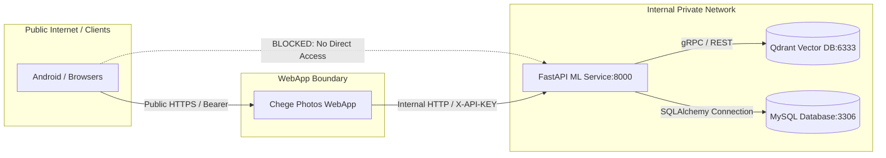

# Threat Model & Security Hardening

STRIDE security evaluation, container network boundary isolation, vector tenant filtering, and input sanitization for ML Chege Photos.

---

## 1. System Security Boundaries

The ML microservice is an internal computer vision engine designed strictly for private backend access:



---

## 2. STRIDE Threat Analysis

| Threat Category | Target Surface | Threat Scenario | Code & Architectural Defense |
|---|---|---|---|
| **Spoofing** | API Key Header (`X-API-KEY`) | An unauthorized container or rogue client on the shared network attempts to invoke face recognition or extract embeddings. | Strict enforcement of `X-API-KEY` header in `app.main.get_api_key`. Constant-time comparison rejects missing or invalid keys with `403 Forbidden`. |
| **Tampering** | Image Payload & Tensors | Maliciously crafted image files (e.g. decompression bombs or polyglot payloads) designed to corrupt computer vision decoders. | OpenCV and Pillow decode safeguards with strict decompression limits (`Image.MAX_IMAGE_PIXELS = 100_000_000`). Images failing decoding are discarded cleanly without crashing the worker. |
| **Repudiation** | Scan & Cluster Invocations | Unaudited batch rescan requests triggering high compute load without traceability. | Structured JSON logging records client IP, target `user_id`, photo IDs, and inference durations for every batch request. |
| **Information Disclosure** | Cross-Tenant Vector Search | User A searches via text query or face cluster and receives nearest-neighbor matches belonging to User B. | Mandatory Qdrant payload filtering. Every search and cluster query injects `models.Filter(must=[models.FieldCondition(key="user_id", match=models.MatchValue(value=user_id))])`. |
| **Denial of Service** | Deep Learning Memory Spikes | Concurrent inference jobs (InsightFace + YOLO + CLIP) cause the Linux kernel to terminate the container (`SIGKILL 137`). | Worker concurrency limits (`ML_CONCURRENT_WORKERS=4`), asynchronous job queueing via `ml_job_queue`, and mandatory 2048 MB minimum RAM sizing. |
| **Elevation of Privilege** | Container Sandbox Escape | An attacker exploiting a vulnerability in ONNX Runtime or PyTorch C++ bindings attempts host privilege escalation. | Containers run as an unprivileged user (`appuser:appuser`, UID 1000) without root privileges or host device mapping. |

---

## 3. Image Hydration & SSRF Protection

When hydrating images dynamically via the `X-Webapp-Url` header:
- The ML service validates that the host resolves strictly to an internal Docker container name (e.g. `chege-photos-webapp`) or a whitelisted LAN subnet.
- Public internet IPs or AWS/GCP metadata endpoints (`169.254.169.254`) are strictly blocked.

---

## 4. Vector Multi-Tenancy Guarantee

Qdrant collections (`face_embeddings`, `face_centroids`, `clip_embeddings`) store high-dimensional vectors with attached metadata payloads:

```python
# SECURE: Multi-tenant filtered search
results = qdrant_client.search(
    collection_name="clip_embeddings",
    query_vector=query_embedding,
    query_filter=models.Filter(
        must=[
            models.FieldCondition(
                key="user_id",
                match=models.MatchValue(value=user_id),
            )
        ]
    ),
    limit=limit,
)
```
