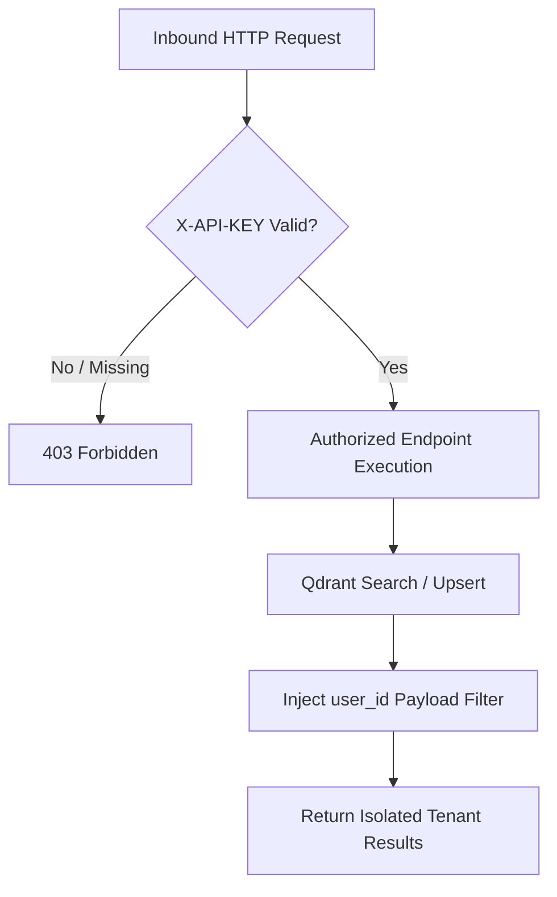

# Engineering Security Architecture

Security protocols, API key authentication, tenant data isolation in Qdrant, and unprivileged container security for ML Chege Photos.

---

## 1. Internal Security Isolation

The ML service is an internal backend component:



---

## 2. API Key Enforcement

* All endpoints outside `/health` and `/metrics` require the `X-API-KEY` header.
* Validated in `app.main.get_api_key` via FastAPI dependency injection:
  ```python
  async def get_api_key(api_key_header_value: str = Depends(api_key_header)):
      if api_key_header_value != settings.ml_api_key:
          raise HTTPException(
              status_code=status.HTTP_403_FORBIDDEN,
              detail="Forbidden: Invalid or missing X-API-KEY credential header"
          )
  ```

---

## 3. Container Security Hardening

* **Non-Root Execution**: Dockerfile specifies an unprivileged user `appuser` (UID 1000).
* **Read-Only Root Filesystem**: Write permissions are constrained exclusively to `/tmp` and model cache directories.
* **Network Binding**: Container binds to internal port 8000 and connects exclusively to the isolated `hosts-shared-network`.
