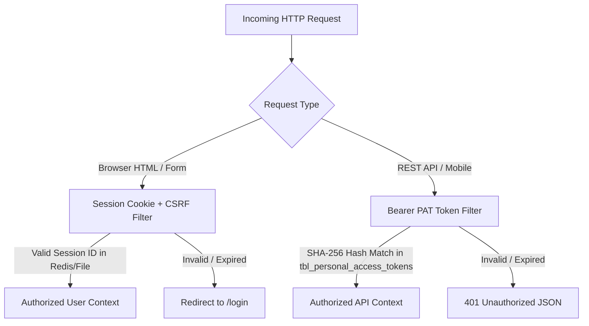

# Engineering Security Architecture

Implementation details of API token authentication, CSRF protections, vault encryption keys, and session management in Chege Photos WebApp.

---

## 1. Authentication Architecture

Chege Photos WebApp employs a dual-mode authentication scheme:



---

## 2. Personal Access Token (PAT) Lifecycle

1. **Generation**: `bin2hex(random_bytes(32))` produces a 64-character token string.
2. **Storage**: Only the `hash('sha256', $token)` is persisted in `tbl_personal_access_tokens`.
3. **Transmission**: Clients pass the raw token via `Authorization: Bearer <token>`.
4. **Validation**: The filter computes the incoming token's SHA-256 hash and performs constant-time string comparison (`hash_equals`) against database records.

---

## 3. Vault Encryption & Zero-Knowledge Architecture

The Private Vault provides secondary encryption for sensitive photos and documents:

* **PIN Key Derivation**: The user's 4-to-6 digit PIN is combined with a tenant-unique salt and passed through PBKDF2/Argon2id to generate the symmetric file decryption key.
* **Master Key**: The derived key never touches persistent disk storage; it exists only in memory during the active vault session.
* **Auto-Lock Timeout**: Inactive vault sessions automatically terminate after 15 minutes of inactivity.

---

## 4. Multi-Tenant Query Scoping Standard

To prevent IDOR (Insecure Direct Object Reference) vulnerabilities, all models and queries must explicitly scope by `user_id = auth()->id()`:

```php
// Standard pattern across all controllers
$album = $this->albumModel->where('id', $albumId)
                          ->where('user_id', auth()->id())
                          ->first();

if (! $album) {
    return $this->failNotFound('Resource not found or unauthorized.');
}
```
