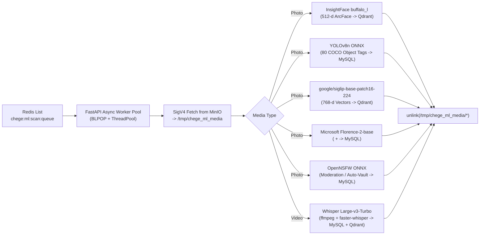

# AI & Machine Learning Microservice (`chege-photos-ml`)

The ML microservice (`ml/`) runs Python 3.12 + FastAPI + `ffmpeg`, pulling all model weights on demand from **`minio://chege-models/`** into ephemeral `/tmp/chege_models` and processing media from **`minio://chege-photos/`** via ephemeral `/tmp/chege_ml_media`.

---

## Multimodal Pipeline Diagram

---

## Active Model Inventory

| Capability | Model | Vector / Output | MinIO Key (`chege-models`) | Runtime |
| :--- | :--- | :--- | :--- | :--- |
| **Face Detection & Recognition** | InsightFace `buffalo_l` (`det_10g.onnx`, `w600k_r50.onnx`) | 512-d ArcFace embeddings | `insightface/buffalo_l/` | ONNX Runtime (CUDA / CPU) |
| **Semantic Visual Search** | `google/siglip-base-patch16-224` | 768-d normalized vectors (`padding="max_length"`) | `siglip/google--siglip-base-patch16-224/` | PyTorch (`ML_DEVICE`) |
| **Dense Captioning & OCR** | `microsoft/Florence-2-base` | `ai_caption` + `ocr_text` | `florence2/microsoft--Florence-2-base/` | PyTorch (`attn_implementation="eager"`) |
| **Video Speech Transcription** | `Whisper Large-v3-Turbo` (CTranslate2) | `audio_transcript` + `transcript_segments` JSON + Qdrant vector | `whisper/large-v3-turbo/` | `faster-whisper` (CPU `int8` default / CUDA `float16` auto) |
| **Object Tagging** | YOLOv8 Nano (`yolov8n.onnx`) | `tbl_photo_tags` | `yolo/yolov8n.onnx` | OpenCV DNN |
| **Safety Moderation** | OpenNSFW ResNet-50 (`open_nsfw.onnx`) | `nsfw_score`, `is_nsfw`, auto-vault | `nsfw/open_nsfw.onnx` | OpenCV DNN / ONNX |

---

## Hardware Acceleration Auto-Detection

- **Default (CPU-only hosts):** `WHISPER_DEVICE=cpu`, `WHISPER_COMPUTE_TYPE=int8`, `ML_DEVICE=cpu`, `TORCH_INDEX_URL=https://download.pytorch.org/whl/cpu`.
- **Automatic GPU Promotion:** When `scripts/deploy.sh` detects `nvidia-smi` and Docker NVIDIA Container Toolkit, it automatically sets `WHISPER_DEVICE=cuda`, `WHISPER_COMPUTE_TYPE=float16`, `ML_DEVICE=cuda`, builds PyTorch from `https://download.pytorch.org/whl/cu124`, and attaches `docker-compose.gpu.yml`.
